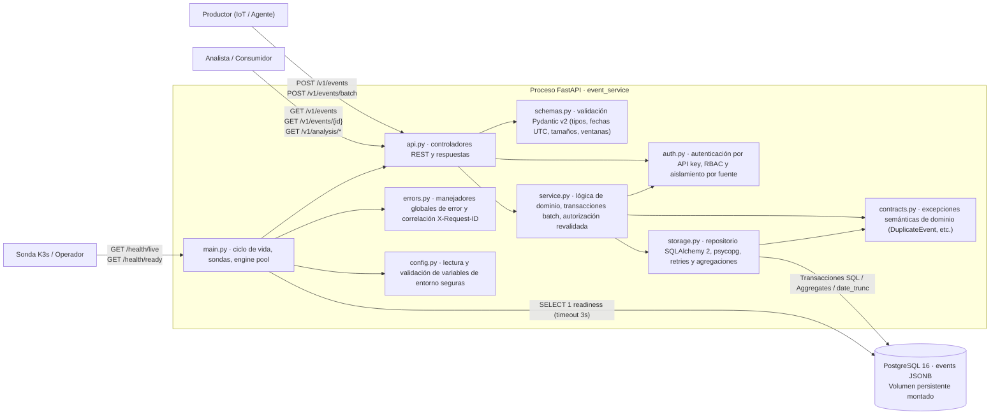

# Contenedores y módulos — Escenario 3 (COM-02)

La arquitectura de ejecución se estructura en dos unidades: el proceso de servicio **`event_service`** (Python 3.13 / FastAPI) y el custodio relacional **PostgreSQL 16**. A lo interno del servicio, los límites entre módulos garantizan separación de incumbencias y alta cohesión sin complejidad innecesaria de microservicios.

| Módulo | Responsabilidad y límites de diseño |
|---|---|
| `main.py`, `config.py` | Inicialización de la aplicación FastAPI, configuración inmutable desde entorno (`Settings`), registro de enrutadores y manejadores de error, y sondas de salud (`/health/live` desacoplado, `/health/ready` vinculado a la base). No contiene lógica de negocio. |
| `api.py`, `schemas.py` | Definición del contrato HTTP público (`/v1/events`, `/v1/events/batch`, `/v1/events/{id}`, `/v1/analysis/*`); validación estricta de payloads JSON (máx 16 KiB), normalización de timestamps a UTC, rechazo de parámetros no permitidos (`extra="forbid"`), límites de ventana de consultas y paginación. No interactúa directamente con la base de datos. |
| `service.py`, `contracts.py` | Dueño lógico de las capacidades del Escenario 3: coordina la ingesta individual y batch atómico, verifica permisos RBAC y autorizaciones específicas por origen (`source`), y orquesta las consultas de eventos y análisis. Dispara excepciones semánticas neutrales de transporte (`EventNotFound`, `DuplicateEvent`, `StorageUnavailable`). |
| `auth.py` | Autenticación basada en cabecera `X-API-Key` y control de acceso RBAC (`producer`, `analyst`). Implementa además restricción lateral por fuente emisora (`EVENT_PRODUCER_SOURCE_KEYS`). Falla cerrado ante claves ausentes, incorrectas o configuraciones inconsistentes. |
| `storage.py`, `alembic/` | Adaptador de persistencia relacional con SQLAlchemy 2. Controla transacciones ACID, rollback automático ante fallos de integridad (`23505`), reintentos controlados con backoff en lecturas operacionales, y traducción de consultas analíticas a SQL optimizado (`date_trunc`, funciones agregadas sobre JSONB). Gestiona migraciones de esquema idempotentes. |
| `errors.py` | Mapeo centralizado de excepciones a respuestas HTTP seguras y consistentes con identificador `X-Request-ID`. Garantiza que ningún error ni registro de log filtre credenciales, cadenas DSN de conexión ni trazas internas de la aplicación. |

**Contratos verificables del API:**
- `POST /v1/events`: `201 Created` con documento del evento creado; `401 Unauthorized` si no hay clave; `403 Forbidden` si el rol no es `producer` o la fuente no está autorizada; `409 Conflict` si ya existe `(source, external_id)`; `422 Unprocessable Entity` si la entrada es inválida.
- `POST /v1/events/batch`: `201 Created` con cantidad y lista de eventos persistidos; `409 Conflict` si hay duplicados internos o con la base de datos (con rollback atómico completo).
- `GET /v1/events/{id}`: `200 OK` con evento; `404 Not Found` público ante identificador inexistente.
- `GET /v1/events`: `200 OK` con listado paginado (`items`, `total`, `limit`, `offset`) acotado por ventana `[from, to)` y filtros opcionales.
- `GET /v1/analysis/counts`: `200 OK` con conteos agrupados por `type` o `source` y total global derivado.
- `GET /v1/analysis/timeseries`: `200 OK` con puntos agrupados por intervalos (`minute`, `hour`, `day`).
- `GET /v1/analysis/summary`: `200 OK` con total de eventos, fuentes únicas, tipos únicos y estadísticas numéricas (`min`, `max`, `avg`) del campo payload solicitado.
- `/health/live`: `200 OK` público e independiente de la conectividad externa.
- `/health/ready`: `200 OK` si PostgreSQL responde a `SELECT 1`, o `503 Service Unavailable` sanitizado si la base está inaccesible o la consulta excede 3 segundos.
