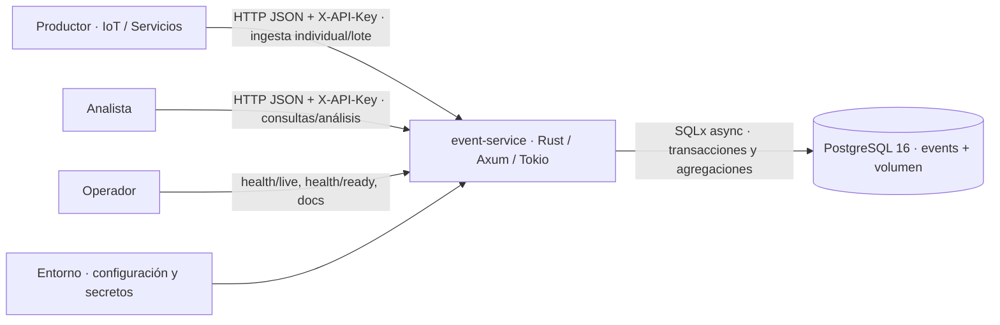

# Contexto · Escenario 3 / COM-02

- **Aplicación:** dueña de reglas, validación, RBAC, aislamiento por fuente y errores seguros. Única unidad de despliegue, sin estado de negocio en memoria.
- **PostgreSQL:** custodio de eventos y consistencia; unicidad `(source, external_id)`, transacciones ACID, índices temporales y JSONB. Analítica ejecutada en SQL.
- **Entorno:** `Settings` inyectado al inicio; credenciales fuera del repositorio y de imágenes. Configuración de acceso ambigua falla cerrado.
- **Cliente:** obtiene 201 solo tras COMMIT, 409 por duplicado, 422 por entrada inválida, 503 si falla persistencia. Puede correlacionar toda respuesta con `X-Request-ID`.

SQL asíncrono no significa consistencia eventual: cada petición espera el resultado confirmado. No hay cola ni confirmaciones 202. Consultas leen snapshots de PostgreSQL; el listado y resumen mantienen un snapshot común entre sus sentencias.
