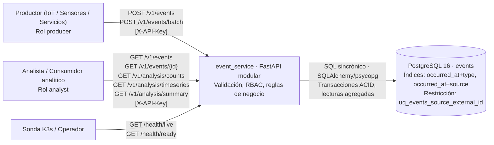

# Contexto — Escenario 3: Ingesta y Análisis de Eventos (COM-02)

**Estado:** Arquitectura real, código y pruebas de aceptación del Escenario 3 implementados y verificados. Interacciones sincrónicas HTTP y SQL probadas contra PostgreSQL 16.

| Límite del componente | Responsabilidad y dato del que responde | Justificación de diseño |
|---|---|---|
| `event_service` (proceso de aplicación) | Autentica vía RBAC y valida alcance por fuente (`allowed_sources`); valida tipos, esquemas, fechas UTC y tamaños; ejecuta reglas de dominio para ingesta puntual, lotes atómicos y consultas analíticas; traduce fallos a errores públicos uniformes con `request_id`. Es el **dueño lógico** del recurso `events`. | Un único componente cohesivo desacoplado en capas evita la sobrecarga operativa, latencia de red y complejidad de transacciones distribuidas para el volumen y requisitos del escenario. |
| `PostgreSQL 16` (custodio de persistencia) | Almacenamiento durable de eventos (`id`, `source`, `external_id`, `type`, `occurred_at`, `ingested_at`, `payload` JSONB); garantía de unicidad `(source, external_id)`; índices de aceleración temporal `(occurred_at, type)` y `(occurred_at, source)`; cálculo de agregados relacionales, buckets de series y resúmenes estadísticos bajo demanda. | Proporciona semántica ACID estricta, consultas JSON estructuradas de alto rendimiento y durabilidad ante reinicios con volumen nombrado. |
| Entorno del proceso (`Settings`) | Provee `DATABASE_URL`, claves de rol (`EVENT_PRODUCER_KEY`, `EVENT_ANALYST_KEY`), claves restringidas por origen (`EVENT_PRODUCER_SOURCE_KEYS`) y configuración de timeouts y resiliencia. Si faltan credenciales o son ambiguas, el sistema falla cerrado. | Garantiza el principio de menor privilegio y separación absoluta de configuraciones y secretos respecto al código y las imágenes. |

**Flujo principal del sistema:**
1. **Ingesta puntual o batch:** El productor envía eventos. La API valida la clave y el permiso del rol y del origen emisor. El servicio valida la unicidad natural intra-batch y contra la base de datos. Si todo es correcto, confirma la transacción (`201 Created`). Si hay duplicado o error, aborta de forma atómica (`409 Conflict` o `422 Unprocessable Entity`).
2. **Consultas y analítica:** El analista autenticado consulta eventos individuales, listados paginados o agregaciones analíticas (conteos dimensionales, series temporales por cubos de tiempo o resúmenes estadísticos). La capa de almacenamiento ejecuta la consulta SQL directamente sobre los índices de la tabla persistida y devuelve resultados ordenados sin requerir almacenamiento duplicado.
3. **Resiliencia ante fallos:** Si PostgreSQL deja de responder, la API reporta `503 Service Unavailable` en operaciones afectadas y en `/health/ready`, pero conserva `/health/live`. Cuando la base se recupera, la misma instancia de la API retoma la atención normal (`200 OK`) sin requerir reinicio del proceso.
