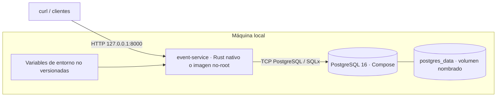

# Despliegue local Rust; Azure/K3s pendiente · COM-02

Seguir el [README](../../README.md#arranque-local). Para binario nativo: `cargo run --locked -- migrate`, luego `cargo run --locked -- serve`. Para contenedor: perfil `app` de Compose; ejecutar `docker compose --profile app run --rm api migrate` y después `docker compose --profile app up -d api`. El runtime escucha `0.0.0.0:8000`, usuario 10001 sin root, certificados CA instalados, sin toolchain ni código fuente.

`DATABASE_URL` del host usa el puerto publicado; dentro de Compose usa `postgres:5432`. La API escucha solo en loopback por defecto fuera de contenedores. No publicar PostgreSQL a Internet. Terminar TLS y aplicar rate limiting en el proxy/ingress.

`examples/verify_system.rs` crea un contenedor de prueba propio y conserva su volumen: prueba recuperación sin reinicio de API y supervivencia a reinicios completos. El volumen demuestra durabilidad ante reinicios, **no** frente a pérdida de disco o VM. Ver [persistencia](persistencia.md).

El workflow compila y prueba Rust y el Dockerfile. Azure, registro de imágenes, Terraform, K3s, requests/limits y despliegues con aprobación requieren sus issues DEV correspondientes. Este diagrama no acredita recursos cloud ni revisión independiente. Cuando existan: documentar manifiesto ↔ recurso observado, digests, probes y PVC; conservar evidencia del despliegue real.
