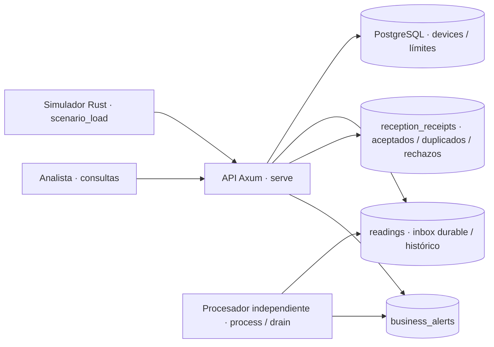

# Escenario 3 · Mantenimiento: ingesta y análisis de lecturas

Contrato específico de la sección 6.3. La API genérica `/v1/events` se conserva
por compatibilidad, **no implementa por sí sola ESC3 y no alimenta sus contadores**.
Para la defensa usar `/v1/devices`, `/v1/readings` y los comandos de esta guía.

## Arquitectura implementada (parte A)



Un binario, dos procesos con responsabilidades diferentes. `serve` **no procesa**
el backlog. PostgreSQL evita incorporar un broker adicional: una lectura confirmada
en el inbox ya es recuperable. La separación es funcional, no exige microservicios.
Kubernetes, publicación/CD e instrumentación de observabilidad quedan a cargo de C y D.

## Contratos y decisiones

- Dispositivo: ID ASCII estable (1–64), instalación (`facility_id`) y límites.
  Alta mediante clave producer global; claves por fuente no pueden crear dispositivos
  ni cambiar límites. No hay borrado ni reasignación del ID.
- Lectura: `event_id` (1–128 caracteres sin NUL, único **por dispositivo**), `device_id`,
  `occurred_at` RFC3339 con zona (normalizado a UTC), `temperature`, `humidity`, `state`.
  Campos adicionales, ausentes, tipos incorrectos y JSON mal formado se rechazan.
- Rangos físicos declarados: temperatura **[-80, 150] °C**, humedad **[0, 100] %**,
  estados **running / stopped / fault**. Son decisiones del equipo, no valores
  atribuidos al PDF. Los límites configurables de negocio deben estar dentro de esos
  rangos y tener mínimo < máximo. Superar un límite de negocio no invalida una lectura.
- `POST /v1/readings`: **202** solo después de COMMIT del evento y su recibo;
  **200** para retransmisión válida, con el mismo `reading_id`, sin sobrescribir datos;
  **422** con recibo durable y motivo seguro para rechazo de validación.
  Se valida antes de deduplicar: una retransmisión con campos inválidos es rechazo.
- Los recibos se verifican por `GET /v1/receipts/{id}` (analyst). No se guarda el
  cuerpo rechazado, secretos ni diagnósticos SQL. El identificador de dispositivo
  se conserva solo si tiene formato seguro; los motivos son `invalid_format`,
  `invalid_fields` o `unknown_device`.
- Contadores de recepción incluyen solicitudes autenticadas, autorizadas y dentro
  del límite HTTP (4 MiB). Fallos de auth, rutas incorrectas o cuerpos excesivos no son
  lecturas recibidas. Un error de DB devuelve 503: no se afirma que el rechazo quedó
  registrado ni que se aceptó el evento. Un COMMIT de resultado incierto se resuelve
  consultando o retransmitiendo el mismo ID; no se reintentan escrituras a ciegas.
- `readings` conserva tanto pendientes como procesadas. Históricos devuelven
  `processed_at` (null = pendiente). Estadísticas y alertas corresponden **solo a
  procesadas**. Todas las ventanas son **[from, to)** por generación, no recepción;
  los listados se ordenan por `(occurred_at, id)` incluso con llegada fuera de orden.
- El procesador toma lotes con `FOR UPDATE SKIP LOCKED`; crea alertas y marca
  procesamiento en **la misma transacción**. Matarlo revierte el lote en vuelo,
  liberando los locks; no existen trabajos perpetuamente `processing` ni leases que
  renovar. Múltiples workers no aplican efectos duplicados sobre una misma lectura.
- Se guardan los límites vigentes **al recibir** la lectura. Cambiarlos afecta las
  nuevas recepciones, no reinterpreta pendientes ni históricos. Una alerta por cada
  magnitud fuera del mínimo/máximo; igualdad al límite no alerta. La unicidad
  `(reading_id, kind)` protege frente a efectos repetidos.
- No se promete exactamente una ejecución general ni tolerancia a perder el disco/VM.
  El inbox y los recibos crecen sin retención automática: alternativa simple y auditable
  para este proyecto; producción requeriría política de archivo/retención.

## Contadores consistentes · ESC3-09

`GET /v1/reception/counts[?device_id=...]`, leído en un único snapshot SQL:

```text
received  = validated + rejected
validated = accepted + duplicates
accepted  = processed + pending
received  = processed + pending + duplicates + rejected
```

`accepted` = lecturas únicas válidas persistidas. `validated` incluye retransmisiones
que pasan validación; **no** se suman al trabajo único ni a los agregados.
La conservación no depende de contadores en memoria: los recibos y estados son la
fuente de verdad tras reinicios. Un filtro por dispositivo excluye rechazos cuyo
dispositivo falta o está mal formado; esos rechazos sí están en el total global.

## API específica

Todas las rutas requieren `X-API-Key`. Contrato completo generado en `/openapi.json`.

| Operación | Rol / contrato |
|---|---|
| `POST /v1/devices` | producer global; `{id, facility_id, limits:{temperature_min,temperature_max,humidity_min,humidity_max}}` |
| `GET /v1/devices` / `GET /v1/devices/{id}` | analyst; listado paginado / detalle |
| `PUT /v1/devices/{id}/limits` | producer global; objeto de límites |
| `POST /v1/readings` | producer global o clave cuya fuente coincide con device_id |
| `GET /v1/receipts/{uuid}` | analyst; recibo verificable |
| `GET /v1/devices/{id}/readings?from=...&to=...` | analyst; histórico aceptado, incluidos pendientes |
| `GET /v1/devices/{id}/statistics?from=...&to=...` | analyst; count + min/max/avg de ambas magnitudes procesadas |
| `GET /v1/devices/{id}/alerts?from=...&to=...` | analyst; alertas persistidas por fecha de generación |
| `GET /v1/reception/counts?device_id=...` | analyst; filtro opcional |
| `GET /v1/rejections?device_id=...` | analyst; rechazos auditables |

Listados: `limit` 1–1000 (100 por defecto), `offset` 0–100000. Estadísticas no
se paginan: limit/offset no limitan el cálculo. Dispositivo desconocido en consultas
históricas devuelve un conjunto vacío; detalle/configuración devuelve 404.

## Pruebas y reproducción

Usar exclusivamente datos ficticios. Arrancar PostgreSQL/API según README y exportar
`DATABASE_URL`, `EVENT_PRODUCER_KEY`, `EVENT_ANALYST_KEY`. No hay migración implícita:

```bash
cargo run --locked -- migrate
# Terminal 1
cargo run --locked -- serve
# Terminal 2: no ejecutar todavía para demostrar crecimiento de backlog.
cargo run --locked -- process
```

`PROCESSOR_BATCH_SIZE` = 100 (1–1000), `PROCESSOR_POLL_MS` = 100 (1–60000).
El delay se aplica tras cada lote para permitir reducir capacidad de forma controlada.
Ante indisponibilidad de DB, `process` registra solo una categoría pública segura y
aplica backoff exponencial: base = máximo de poll/read-backoff y 100 ms, techo 60 s;
una consulta exitosa reinicia el backoff. Errores no recuperables terminan el proceso.
`process` espera nuevas entradas y reintenta ante DB no disponible. `drain` termina
cuando no ve pendientes disponibles y falla si DB no está disponible. Para acreditar
backlog cero ejecutar `drain` **sin otros workers ni entrada nueva**, y verificar counts.

### Aceptación automática (incluida en CI existente)

```bash
cargo test --locked --all-targets
# BD dedicada test_* o *_test; DATABASE_URL debe coincidir si existe.
cargo test --locked --test postgres -- --ignored --nocapture
```

`tests/scenario3/mod.rs`, incluido en `tests/postgres.rs`, comprueba:
1. 1,000 válidos confirmados y pendientes con worker detenido;
2. prueba adicional identificada de 50 duplicados + 50 eventos fuera de orden;
3. concurrencia de retransmisiones, rechazos, auth y límites;
4. nueva conexión/migración sin pérdida, muerte real del worker, recepción con worker
   detenido, recuperación sin nueva entrada y backlog cero;
5. agregados exactos, [inicio, fin), orden temporal, alertas sin duplicar y límites
   versionados por recepción.

`examples/verify_system.rs` reinicia procesos reales de API **y PostgreSQL** conservando
volumen; compara dispositivos, límites, recibos, rechazos, alertas e históricos completos,
además de comprobar que el pendiente sobrevive y puede drenarse después.

### Generador reproducible · ESC3-10

```bash
mkdir -p artifacts
# 1,000 válidos + 20 rechazos adicionales (no cuentan como válidos).
cargo run --locked --example scenario_load -- burst --seed 3 > artifacts/esc3-burst.json
# Prueba adicional separada: 1,000 únicos + 50 tardíos únicos + 50 duplicados + 20 rechazos.
cargo run --locked --example scenario_load -- extra --seed 3 > artifacts/esc3-extra.json
# Exactamente 2,400 únicos a 20/s durante 120 segundos.
cargo run --locked --example scenario_load -- sustained --seed 3 > artifacts/esc3-sustained.json
```

Cada ejecución crea un dispositivo nuevo (usar `--run identificador` para nombrarlo;
no reutilizarlo). Datos iguales para igual seed; fechas ficticias fijas en UTC.
`ESC3_BASE_URL` apunta al destino (por defecto localhost). No seguir redirects con claves.
Hasta 64 solicitudes concurrentes; un destino lento produce retraso de programación
visible, no una falsa afirmación de 20/s. El perfil sustained no admite alterar sus
umbrales; para experimentar:

```bash
cargo run --locked --example scenario_load -- custom --count 100 --rate 10 --invalid 10 --duplicates 5 --late 5 --seed 42
```

El JSON contiene aceptación, rechazo, duplicados, solicitudes inciertas, latencia p50/p95/max,
retraso de emisión, duración, pendientes y pérdida de aceptados mediante comparación de
UUIDs con histórico durable. Falla con código no cero ante discrepancias. Una solicitud
sin respuesta es incierta, no automáticamente rechazada ni perdida.

Para la prueba de backlog: ejecutar burst sin worker, guardar counts, iniciar `process`
con lote 1/poll 500, detener **solo ese proceso** con Ctrl-C (o matar el proceso propio
para simular crash), guardar counts, luego ejecutar `drain` con lote 100 y sin nueva
entrada. Guardar counts final con pending=0 y accepted=processed. No detener DB ni
usar comandos destructivos sobre recursos compartidos.

Los reportes son evidencia funcional y de carga de A, **no sustituyen** SLIs/SLOs,
Prometheus, dashboards, trazas ni el análisis de incidente de D.

## Entrega de A a B, C y D

La API específica y el procesador están listos para integración. Esto no acredita
que la plataforma completa esté desplegada ni que se hayan satisfecho DEV/MET.

- **B:** conservar el Terraform/estado remoto entregados y completar evidencia de
  plan/apply autenticado desde Actions, apagado operativo y gasto acumulado. No
  ejecutar un apply o reemplazo de VM solo para demostrar esta funcionalidad.
- **C:** construir el mismo binario/imagen y desplegar `serve` y `process` por
  separado; ejecutar `migrate` antes de habilitar tráfico. API y worker requieren
  `DATABASE_URL`; API requiere además las claves configuradas. Proteger PostgreSQL
  con persistencia fuera del ciclo de vida del Pod y separar configuración/datos
  entre desarrollo y producción. El worker no ofrece HTTP: no copiarle las probes
  HTTP de la API sin diseñar una comprobación apropiada.
- **D:** instrumentar recepción/procesamiento y usar el ledger como fuente de
  contadores consistentes. La relación durable `receipt.id → reading_id → alert`
  sirve para correlación de dominio, **no sustituye** propagación/enlaces de spans
  OpenTelemetry. Agregar SLIs/SLOs, señales, dashboards, alertas e incidente según
  el Anexo II sin confundir alertas de negocio con alertas operativas.

La aceptación de la parte A no cierra automáticamente los issues DEV/MET. Tras el
despliegue integrado, repetir los perfiles de carga y el experimento de recuperación
en condiciones de defensa, con cuentas y datos ficticios y sin destruir la VM.

## Matriz de cobertura

| Requisito | Implementación / evidencia ejecutable |
|---|---|
| ESC3-01 | devices, alta/detalle/límites, prueba de instalación y ID estable |
| ESC3-02 | ReadingCreate, UTC y contrato estricto; aceptación HTTP |
| ESC3-03 | Validación y reception_receipts; JSON mal formado/campos/rangos/dispositivo |
| ESC3-04 | COMMIT previo a 202; histórico por dispositivo/[from,to); reinicio real |
| ESC3-05 | UNIQUE(device_id,event_id), recibos duplicate; concurrencia y agregados |
| ESC3-06 | min/max/avg de temperatura/humedad de procesadas, por generación |
| ESC3-07 | Límites por dispositivo, snapshot y business_alerts transaccionales |
| ESC3-08 | Orden occurred_at/id; 50 tardíos y ventanas semiabiertas |
| ESC3-09 | Ledger durable, identidades documentadas y snapshot de counts |
| ESC3-10 | scenario_load: burst, extra, sustained y custom; JSON verificable |

Los resultados locales deben enlazarse a su revisión concreta. No declarar CI,
Kubernetes ni carga Azure ejecutados basándose solo en estas instrucciones.
