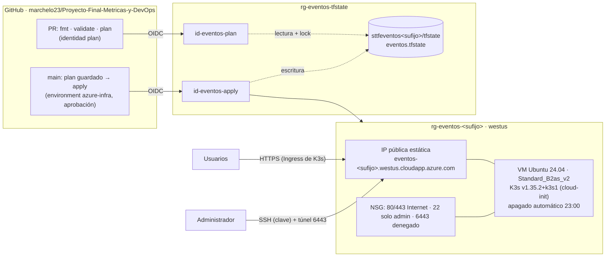

# Infraestructura en Azure · DEV-06, DEV-07, DEV-08, DEV-13

La plataforma corre en **un clúster K3s de un solo nodo** sobre una VM de Azure creada con Terraform. Development y production se separan **lógicamente** con namespaces dentro del mismo clúster (condición 5.4 del proyecto). Este documento cubre la infraestructura de Azure; los manifiestos de Kubernetes, la publicación de imágenes y la entrega continua pertenecen a DEV-02…05 y DEV-09…12.

## Arquitectura



| Recurso | Nombre | Propósito |
|---|---|---|
| Resource Group | `rg-eventos-<sufijo>` | Contenedor de la plataforma (Terraform) |
| VNet / subred | `vnet-eventos-<sufijo>` · `snet-k3s` (10.40.1.0/24) | Red privada de la VM |
| NSG | `nsg-eventos-<sufijo>-k3s` | 80/443 desde Internet, 22 solo desde `admin_cidrs`, 6443 denegado |
| IP pública | `pip-eventos-<sufijo>-k3s` | Estática, Standard, con etiqueta DNS `eventos-<sufijo>` |
| VM | `vm-eventos-<sufijo>-k3s` | Ubuntu 24.04, `Standard_B2as_v2` (2 vCPU, 8 GB), disco StandardSSD de 64 GB |
| Apagado automático | `shutdown-computevm-vm-eventos-<sufijo>-k3s` | Desasigna la VM todos los días a las 23:00 (hora de Centroamérica) |
| Presupuesto | `budget-eventos-<sufijo>` | US$100 mensuales a nivel de suscripción; alertas al 50 % y 80 % reales y al 100 % pronosticado |

### Decisiones

- **Región `westus`.** La política de la suscripción permite `westus`, `northcentralus`, `westus3`, `mexicocentral` y `canadacentral`. En `mexicocentral` los tamaños burstable no están disponibles para Azure for Students (`NotAvailableForSubscription`); `westus` ofrece la serie B sin restricciones.
- **`Standard_B2as_v2` (2 vCPU, 8 GB).** El nodo aloja K3s, la API en dos namespaces, PostgreSQL y la observabilidad (Prometheus, Grafana, OpenTelemetry Collector, visor de trazas). Con 4 GB la memoria quedaría al límite; el tamaño se revisará con el consumo observado y los requests de DEV-11.
- **Un nodo, sin HA.** El proyecto no exige alta disponibilidad ni tolerancia a la pérdida de la VM. Un reinicio de Pod no equivale a perder la VM.
- **K3s por cloud-init.** Versión fija `v1.35.2+k3s1`, la misma que se usó en clase. Cambiar la versión o el template **reemplaza la VM** (y los volúmenes `local-path`); el plan lo muestra antes de aplicar.
- **API de Kubernetes cerrada.** El puerto 6443 no se publica. La administración se hace por SSH con clave (sin contraseña) y un túnel: `ssh -N -L 6443:127.0.0.1:6443 azureuser@<fqdn>`.
- **DNS y TLS.** La IP tiene una etiqueta DNS de Azure (`<label>.westus.cloudapp.azure.com`), que sirve de nombre para el Ingress y para el certificado TLS que emita el clúster.

## Estado remoto · DEV-07

| Elemento | Valor |
|---|---|
| Resource Group | `rg-eventos-tfstate` (creado por el bootstrap, fuera de Terraform) |
| Storage Account | `sttfeventos<sufijo>`, StorageV2, TLS 1.2, HTTPS, **sin acceso por access key** ni acceso público |
| Container / key | `tfstate` / `eventos.tfstate` |
| Autenticación | Microsoft Entra ID (`use_azuread_auth = true`) |
| Protección | Versionado de blobs y retención de borrado de 14 días (blobs y containers) |
| Locking | Lease del blob durante `plan` y `apply` |

Accesos al state:

| Principal | Rol | Alcance |
|---|---|---|
| Usuario que ejecuta el bootstrap | Storage Blob Data Contributor | Storage del state |
| `id-eventos-plan` | Reader (suscripción) · Storage Blob Data Contributor (state) | Plans en PR |
| `id-eventos-apply` | Contributor (suscripción) · Storage Blob Data Contributor (state) | Apply desde `main` |

El state nunca se versiona y no se abre ni se publica. Si se pierde, la infraestructura sigue existiendo, pero Terraform deja de saber qué administra; el versionado permite recuperar la versión anterior del blob.

## Terraform en GitHub Actions · DEV-08

Workflow [`terraform.yml`](../../.github/workflows/terraform.yml):

| Evento | Jobs | Identidad |
|---|---|---|
| PR que toca `infra/**` | `fmt -check`, `validate` y **speculative plan** publicado en el resumen | `id-eventos-plan` (subject `pull_request`) |
| PR desde un fork | Solo `fmt` y `validate`; el plan se omite con un aviso (los forks no reciben token OIDC) | — |
| Push a `main` con cambios en `infra/terraform/**`, o ejecución manual | `plan -out=tfplan` y `apply tfplan`, **después de la aprobación** del environment `azure-infra` | `id-eventos-apply` (subject `environment:azure-infra`) |

Ningún PR aplica cambios. El apply solo ocurre con código integrado y aprobado, y aplica exactamente el plan guardado.

### Configuración del repositorio (una vez, la hace un administrador)

1. **Settings → Environments → New environment `azure-infra`** → *Required reviewers* (al menos un integrante distinto de quien hizo el cambio). Crear el environment con revisores **antes** de definir `APPLY_CLIENT_ID`.
2. **Settings → Secrets and variables → Actions → Variables:**

| Variable | Origen |
|---|---|
| `AZURE_SUBSCRIPTION_ID`, `AZURE_TENANT_ID` | `infra/bootstrap/bootstrap.env` |
| `PLAN_CLIENT_ID`, `APPLY_CLIENT_ID` | `infra/bootstrap/bootstrap.env` |
| `INFRA_NAME_SUFFIX`, `INFRA_LOCATION` | `infra/bootstrap/bootstrap.env` |
| `INFRA_ADMIN_SSH_PUBLIC_KEY` | Clave pública SSH del administrador |
| `INFRA_ADMIN_CIDRS` | Lista HCL, por ejemplo `["203.0.113.10/32"]` |
| `INFRA_BUDGET_CONTACT_EMAILS` | Lista HCL, por ejemplo `["integrante@esen.edu.sv"]` |

Ninguno es un secreto: el acceso a Azure usa OIDC y no hay contraseñas en el repositorio.

## Reconstrucción desde cero · DEV-13

Prerrequisitos: Azure CLI con sesión de un **Owner** de la suscripción (`az login`), GitHub CLI (`gh auth login`), Terraform ≥ 1.12, Git Bash o Linux, `openssl` y un par de claves SSH. En Windows con Git Bash, los scripts ya exportan `MSYS_NO_PATHCONV=1`.

1. **Bootstrap** (único paso fuera de Terraform; crea identidades y RBAC, por eso lo ejecuta un Owner):

   ```bash
   bash infra/bootstrap/bootstrap.sh
   ```

2. Confirmar que `infra/terraform/backend.hcl` tenga el `storage_account_name` que imprimió el bootstrap.
3. Crear `infra/terraform/terraform.tfvars` a partir de `terraform.tfvars.example` con los valores de `infra/bootstrap/bootstrap.env`, la clave pública SSH, la IP de administración y los correos del presupuesto.
4. Aplicar:

   ```bash
   cd infra/terraform
   export ARM_USE_CLI=true
   terraform init -backend-config=backend.hcl
   terraform plan -out=tfplan
   terraform apply tfplan
   ```

5. Verificar K3s (cloud-init tarda unos minutos después de que la VM arranca):

   ```bash
   ssh azureuser@$(terraform output -raw public_fqdn) 'sudo k3s kubectl get nodes -o wide'
   ```

6. Para administrar desde el equipo local: `bash infra/scripts/kube-access.sh`, abrir el túnel que indica y usar `KUBECONFIG=./kubeconfig kubectl get nodes`.
7. Configurar el repositorio (sección anterior) para que los cambios siguientes pasen por el workflow.

Intervenciones manuales declaradas: el bootstrap (identidades, credenciales federadas y backend), la configuración del environment y las variables de GitHub, y la creación del par de claves SSH. Todo lo demás lo crea Terraform.

## Operación y eliminación

```bash
bash infra/scripts/vm.sh status   # estado de energía
bash infra/scripts/vm.sh start    # antes de trabajar, de una demostración o de la defensa
bash infra/scripts/vm.sh stop     # desasigna: deja de cobrarse el cómputo
```

Eliminar la plataforma (los datos de los volúmenes del clúster se pierden):

```bash
cd infra/terraform && ARM_USE_CLI=true terraform destroy
az group delete --name rg-eventos-tfstate   # solo al cerrar el proyecto: elimina el state
```

Costos y presupuesto: [costos.md](costos.md).
